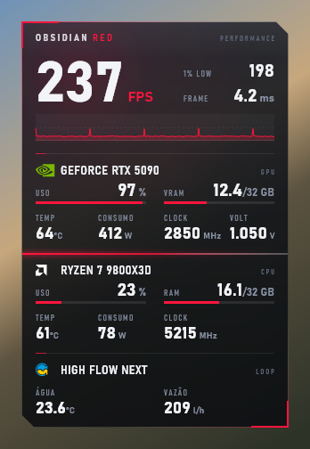
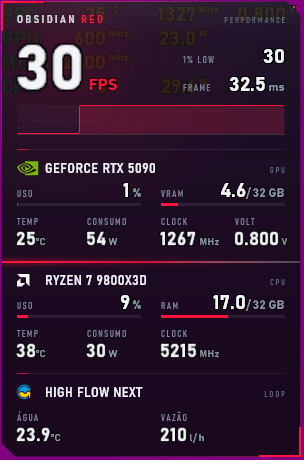

# Obsidian Red II — overlay para o RivaTuner (RTSS)

Layout para o **OverlayEditor** do RivaTuner Statistics Server: FPS, 1% low, frametime com gráfico, GPU, CPU, RAM e o **water cooling Aqua Computer** (temperatura da água e vazão do high flow NEXT). Tudo direto do RTSS, sem programa extra rodando.

<p align="center">
  
  &nbsp;&nbsp;
  
</p>

<sub>À esquerda: prévia gerada pelo `ovlart` com valores de exemplo sobre um fundo simulado. À direita: captura real do RTSS no DesktopOverlayHost (o roxo é o fundo dessa janela).</sub>

## O que mostra

| Seção | Dados |
|---|---|
| Desempenho | FPS, 1% low, frametime, gráfico de frametime (0–25 ms) |
| GPU | uso e VRAM (com barra), temperatura, consumo, clock, tensão |
| CPU | uso e RAM (com barra), temperatura, consumo, clock |
| Água | temperatura da água e vazão do Aqua Computer high flow NEXT |

Só há barra onde ela faz sentido (uso e memória). As temperaturas mudam de cor: branco → âmbar → vermelho.

| Sensor | Âmbar a partir de | Vermelho a partir de |
|---|---|---|
| GPU | 70 °C | 83 °C |
| CPU | 75 °C | 88 °C |
| Água | 35 °C | 40 °C |

## Requisitos

- RivaTuner Statistics Server **7.3.5 ou mais novo**, com o plugin OverlayEditor (vem no instalador do RTSS).
- Windows 10/11 (usa a fonte Bahnschrift, que já vem no sistema).
- Opcional: **Aqua Computer high flow NEXT** ligado na USB. Sem ele, a seção de água mostra `--`.

## Instalação

Num PowerShell **como administrador**:

```powershell
git clone https://github.com/xdzleo/obsidian-red-rtss
cd obsidian-red-rtss
powershell -ExecutionPolicy Bypass -File .\install.ps1 -Restart
```

O `install.ps1`:

1. copia `overlay\ObsidianRed2.ovl` e `overlay\ObsidianRed2\` para `Plugins\Client\Overlays` do RTSS;
2. acha o número de série do seu high flow NEXT e grava no layout (o sensor se chama `/usbhid/0C70/F012/<serial>`);
3. liga o grupo `controller` do LibreHardwareMonitor que vem com o RTSS (`LHMDataProvider\Exporter.config`), que é onde ficam os aparelhos Aqua Computer;
4. deixa o `ObsidianRed2.ovl` como layout ativo do OverlayEditor;
5. com `-Restart`, reinicia o RTSS.

Ele faz backup (`*.bak`) de cada arquivo que altera, só na primeira vez. Use `-DryRun` para ver o que seria feito sem mexer em nada. Para voltar ao layout anterior, escolha outro no OverlayEditor ou restaure o `OverlayEditor.cfg.bak`.

## Hardware diferente

O nome da GPU (`GEFORCE RTX 5090`) e da CPU (`RYZEN 7 9800X3D`) faz parte da arte. Para trocar, edite as chamadas `Header(...)` em `Gpu()` e `Cpu()` no [`tools/ovlart/Program.cs`](tools/ovlart/Program.cs) e gere a arte de novo. Os valores (temperatura, clock etc.) vêm do HAL do RTSS e funcionam em qualquer GPU ou CPU.

## Gerar a arte de novo

A arte (painel, rótulos e logos) é um PNG, e os valores ficam em camadas de texto do OverlayEditor. O `ovlart` gera **os dois a partir das mesmas coordenadas**, então nada fica desalinhado.

1. Instale o .NET 10 SDK.
2. Copie o SkiaSharp 3.119 para `tools/ovlart/lib/`: o `SkiaSharp.dll` e o `runtimes\win-x64\native\libSkiaSharp.dll`. Os dois vêm na pasta do aquasuite, ou no pacote NuGet `SkiaSharp`.
3. Gere:

```powershell
dotnet build tools/ovlart -c Release -o build/bin
dotnet build/bin/ovlart.dll overlay/ObsidianRed2 build/out
```

Isso cria `build/out/atlas.png`, `build/out/ObsidianRed2.ovl` e `build/out/preview.png`. Copie os dois primeiros para `overlay/` (o atlas vai em `overlay/ObsidianRed2/`) e rode o `install.ps1`.

O gerador avisa (`WARN`) quando o pior caso de um valor, por exemplo `3000 MHz`, não cabe na coluna.

O emblema da Aqua Computer foi vetorizado com o [`tools/trace_logo.py`](tools/trace_logo.py) (Python, numpy e Pillow) a partir do ícone do aquasuite. A sombra do PNG fica de fora porque o script separa azul e amarelo pelos canais pré-multiplicados.

## Como a temperatura da água é lida

O high flow NEXT manda pela USB, uma vez por segundo, um relatório HID de 164 bytes (ID `0x01`). Os campos são big-endian:

| Offset | Campo | Escala |
|---|---|---|
| 81 | vazão | ÷10 → l/h |
| 85 | temperatura da água | ÷100 → °C |
| 87 | sensor externo | ÷100 → °C (`0x7FFF` = desconectado) |
| 89 | qualidade da água | ÷100 → % |
| 95 | condutividade | ÷10 → µS/cm |

O LibreHardwareMonitorLib 0.9.5, que vem com o RTSS 7.3.5, já decodifica esse relatório. Só que o grupo dele vem desligado, e o `install.ps1` liga. O aquasuite pode continuar aberto, porque o Windows permite várias leituras ao mesmo tempo no mesmo dispositivo HID.

## Notas sobre o OverlayEditor (descobertas na prática)

- `<S=-n>` dentro de uma camada é **n% da fonte base** (20 px), não do `Size` da camada.
- A fonte do RTSS não tem `Á`, `Ã` etc.: eles aparecem como `⋮`. O `°` funciona. Por isso os rótulos estão desenhados na arte.
- Cor dinâmica: `TextColor=cor0,,lim1,cor1,lim1,lim2,cor2,lim2,(Nome da fonte,0)`.
- Os arquivos `.ovl` são ANSI (Windows-1252). Salvar como UTF-8 quebra o `°C`.
- Para ver o overlay sem jogo, abra o `DesktopOverlayHost64.exe` da pasta do RTSS.
- Ao reiniciar o RTSS na mão, feche também o `RTSSHooksLoader64` e o `LHMDataProvider`. Senão o RTSS novo fecha sozinho.

## Marcas

NVIDIA e GeForce são marcas da NVIDIA Corporation. AMD e Ryzen são marcas da Advanced Micro Devices, Inc. Aqua Computer, high flow NEXT e aquasuite são marcas da Aqua Computer GmbH & Co. KG. Os logos servem só para identificar o hardware de cada seção; veja as origens em [`overlay/ObsidianRed2/LOGOS.md`](overlay/ObsidianRed2/LOGOS.md). Este projeto não tem ligação com essas empresas.

## Licença

Código (`tools/`, `install.ps1`) e layout sob a [licença MIT](LICENSE). Os logos não fazem parte da licença: eles continuam pertencendo aos seus donos.
